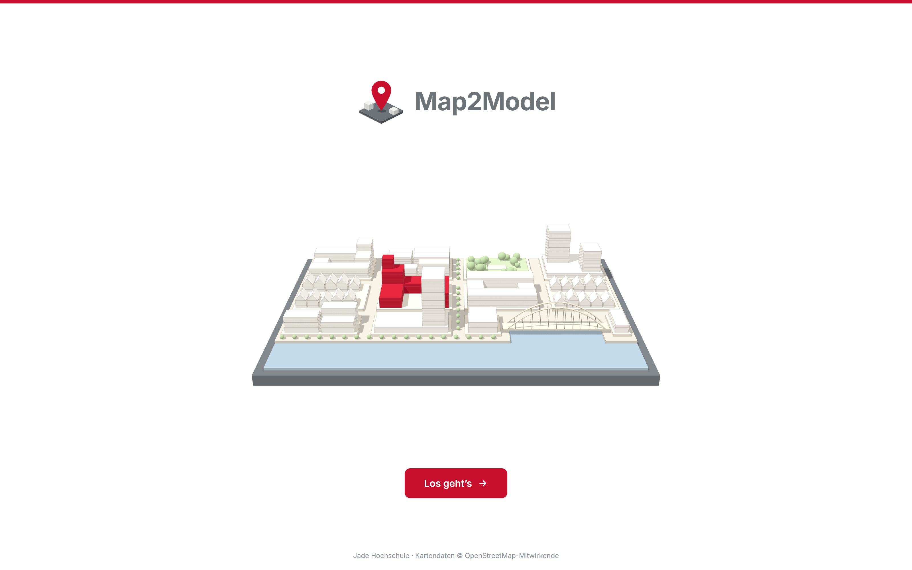
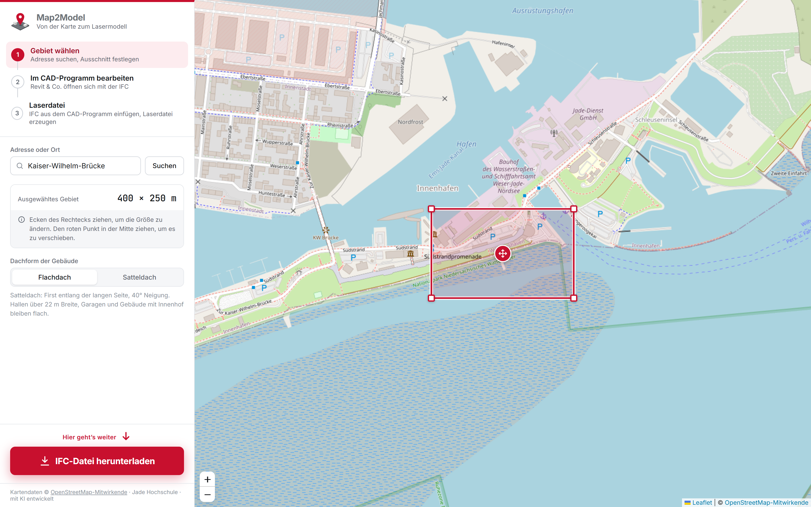
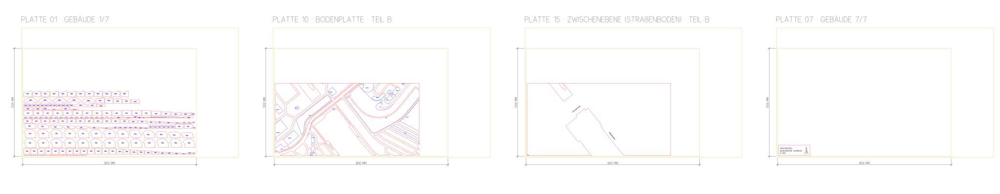

# Map2Model

**Von der Karte zum Lasermodell:** Adresse eingeben, Gebiet wählen, im CAD-Programm Abriss und Neubau planen – und eine fertige Laserdatei für ein Städtebaumodell nach den Regeln der Jade Hochschule herunterladen.

**Live-Demo:** https://jade-hs-vibecoding-wpk.github.io/Map2Model/

Entstanden in der **Vibecoding KI-Werkstatt** (WPK, Fachbereich Architektur, Jade Hochschule, 16.–20.11.2026).

---

## Was macht das Tool?

Ein Umgebungsmodell zu lasern dauert normalerweise Tage: Pläne abzeichnen, Höhen schätzen, jede Platte von Hand für den Laser vorbereiten. Map2Model macht das in drei Schritten:

| Schritt | Was passiert |
|---|---|
| **1 · Gebiet wählen** | Adresse suchen, Rechteck auf der Karte ziehen, **IFC-Datei herunterladen**. Gebäude (mit Höhe aus OpenStreetMap), Straßen, Wasser, Grün, Bäume und Brücken – jedes Teil als eigenes *Allgemeines Modell*. Wahlweise Flach- oder Satteldach. |
| **2 · Im CAD-Programm bearbeiten** | Die IFC in Revit (oder Archicad, Vectorworks …) öffnen, Abriss löschen, Neubauten einsetzen und benennen, z. B. `Neubau_Gebäude_1`, als IFC exportieren. |
| **3 · Laserdatei erzeugen** | Die bearbeitete IFC einfügen, Maßstab, Platte und Material wählen – Map2Model schneidet alles in Pappschichten und verteilt es auf Platten. Heraus kommt **eine DXF-Datei mit allen Platten** plus Bauplan. |

### Die Laserdatei

- Alle Platten in **einer DXF** (und SVG), über jeder Platte ihr Name („PLATTE 01 · GEBÄUDE 1/5“), jede Pappe **bemaßt**.
- Farben nach den **Laserregeln der Jade HS**: Rot = schneiden, Blau = ritzen, Gelb = Rahmen 1000 × 600 mm, Schwarz = gravieren. Linienstärke 0,00 mm, mind. 5 mm Abstand, keine doppelten Linien – wird automatisch geprüft.
- **Grundplatte in Ebenen:** Straßen und Wasser liegen tiefer, Grün höher. Zu große Gebiete werden auf mehrere Platten (Teil A, B, …) aufgeteilt.
- **Gebäude geschichtet oder als Volumen** (Wände + Dach). Jedes Teil trägt seine Nummer – fein geritzt auf der Rückseite, am fertigen Modell unsichtbar. Wahlweise auch ohne Beschriftung.
- **Straßennamen** werden auf den Straßenboden graviert, ein **Schild** mit Beschriftung, Maßstab und **Nordpfeil** wird mitgeschnitten.
- Dazu ein **Bauplan** (`Bauplan_Uebersicht.html`) mit Lageplan, Bauanleitung und Einkaufsliste („24 Platten à 800 × 500 mm“).

---

## Starten

### Online
Einfach die **Live-Demo** öffnen: https://jade-hs-vibecoding-wpk.github.io/Map2Model/ – läuft im Browser, keine Installation, kein Konto.

### Auf dem eigenen Rechner (Windows)
1. Repository herunterladen (grüner Button **Code → Download ZIP**) und entpacken.
2. Doppelklick auf **`Map2Model starten.cmd`**.
3. Es öffnet sich ein kleines Fenster (der lokale Server) und der Browser mit Map2Model. Zum Beenden das Fenster schließen.

Eine Internetverbindung wird gebraucht (Kartendaten und Bibliotheken kommen aus dem Netz). Direkt zu einem Ort springen: `http://localhost:8080/?ort=53.5128,8.1432,Kaiser-Wilhelm-Brücke#gebiet`

### Optional: Revit öffnet die IFC automatisch
In Schritt 2 kann Map2Model euer CAD-Programm direkt starten. Dafür braucht der PC einmalig den kleinen **Map2Model-Öffner** (Ordner `oeffner/`, Download auch in der App): `Installieren.cmd` doppelklicken, kein Admin nötig. Für Revit 2026 wird ein kleines Add-in eingerichtet, das die IFC nach dem Start öffnet (Revit fragt einmal → „Immer laden“). Entfernen: `Deinstallieren.cmd`.

---

## Technik

- Reine **Browser-App** (HTML, CSS, JavaScript), kein Server, kein Build-Schritt, keine API-Keys.
- IFC wird im Browser geschrieben (IFC2X3) und mit **web-ifc** wieder eingelesen; DXF (R12), SVG und ZIP schreibt Map2Model selbst.
- Ordner: `index.html`, `css/`, `js/` (je Baustein eine Datei), `img/`, `oeffner/` (CAD-Öffner + Revit-Add-in), `addin/` (Quellcode des Revit-Add-ins, C#), `start/` (lokaler Server).
- Projektgedächtnis: [`PLAN.md`](PLAN.md) (Ziel, Regeln, Stand) und [`CLAUDE.md`](CLAUDE.md) (Arbeitsregeln für die KI).

---

## Quellen & KI-Nutzung

**Daten**
- Karten und Geodaten: © OpenStreetMap-Mitwirkende, Lizenz **ODbL** (Open Database License) – https://www.openstreetmap.org/copyright. Abgerufen live über die **Overpass API** (Ersatz: OpenStreetMap-API) und die Adresssuche **Nominatim**.
- Gebäudehöhen: OSM `height` bzw. `building:levels` × 3 m, sonst Schätzung (2 Geschosse).
- Keine Daten aus Google Maps/Earth.

**Bilder**
- Alle Screenshots in `docs/screenshots/` sind eigene Bildschirmfotos aus Map2Model (Kartenausschnitt © OpenStreetMap-Mitwirkende).
- Logo: eigener Entwurf.

**Bibliotheken**

| Bibliothek | Version | Lizenz | Wofür |
|---|---|---|---|
| [Leaflet](https://leafletjs.com) | 1.9.4 | BSD-2-Clause | Karte |
| [polygon-clipping](https://github.com/mfogel/polygon-clipping) | 0.15.7 | MIT | Flächen verschneiden und vereinigen |
| [web-ifc](https://github.com/ThatOpen/engine_web-ifc) | 0.0.66 | MPL-2.0 | IFC einlesen |
| [three.js](https://threejs.org) | r128 | MIT | 3D-Modell auf der Startseite |
| Schriften Inter, JetBrains Mono (Google Fonts) | – | SIL Open Font License 1.1 | Oberfläche |
| Revit API (Autodesk) | 2026 | proprietär, nur referenziert | Revit-Add-in |

**KI-Nutzung**
- Werkzeug und Modell: **Claude Code** (Anthropic), Modell **Claude Opus**, 16.–20.11.2026.
- Zweck: Planung, Programmierung des gesamten Codes, Texte dieser README, Screenshots.
- Umfang: Der Code wurde überwiegend von Claude Code geschrieben. **Idee, Ablauf, Gestaltungsentscheidungen, fachliche Regeln (Laserregeln, Modellbau), Tests in Revit und im Browser sowie die Abnahme** kamen von uns. Wir haben nicht selbst programmiert, sondern beschrieben, getestet und korrigiert.
- Es gelten die Regeln der Jade Hochschule zur KI-Nutzung.

---

## Lizenz

Code: Apache License 2.0 (siehe [`LICENSE`](LICENSE)). Die Daten bleiben unter ODbL – bei Weitergabe von Modellen und Laserdateien „© OpenStreetMap-Mitwirkende“ angeben.
